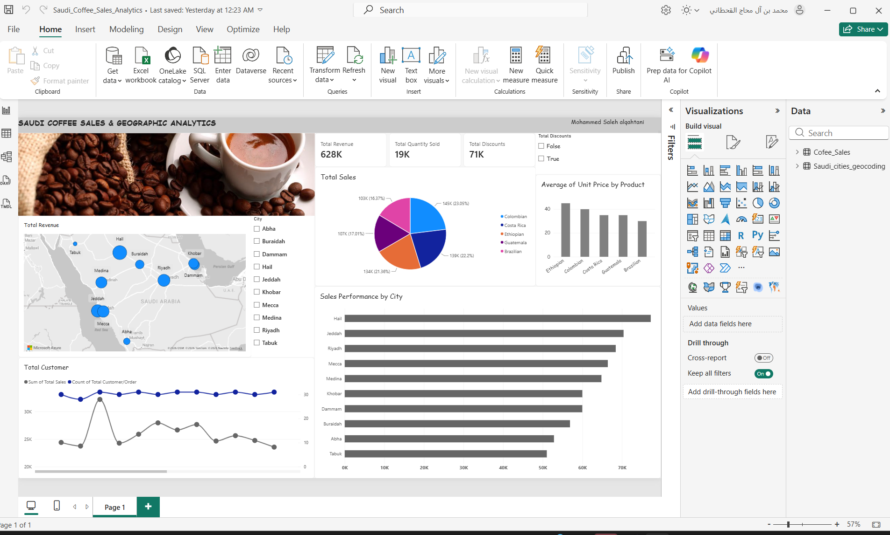

# ☕ Saudi Coffee Market - Sales & Geographic Analytics Dashboard

An executive-level Power BI analytics dashboard designed to analyze sales performance, customer demographic distributions, product pricing, and promotion/discount effectiveness across key Saudi Arabian cities.



🔗 [Click Here to Access the Live Interactive Power BI Dashboard]( https://app.powerbi.com/view?r=eyJrIjoiZDYyN2VhZmMtY2IwYy00MGJhLWExMzEtZDhkZTA3ODI1NDBhIiwidCI6IjNlMDNiMmEzLWNkM2EtNDZmNy1iMDUxLTc2YjQzMzQ0Zjk5MyIsImMiOjl9)**

---

## 📌 Executive Summary
This interactive Power BI dashboard provides a consolidated view of business metrics for coffee distribution across Saudi Arabia. By analyzing primary transaction logs and geographic spatial datasets, it identifies revenue drivers, high-performing territories, discount efficiency, and product mix performance.

### 🔑 Key Performance Indicators (KPIs)
* **Total Revenue:** $628K
* **Total Volume Sold:** 19K Units
* **Total Discount Amount:** $71K

---

## 📊 Key Business Insights & Analytical Breakdown

### 1. Geographic Performance (Regional Sales)
* **Top Performing Cities:** **Hail** and **Jeddah** represent the highest revenue-generating hubs, followed closely by **Riyadh** and **Mecca**.
* **Regional Distribution:** Geographic analysis via the spatial map visual indicates strong penetration in key metropolitan regions (Central & Western Saudi Arabia), with growth potential identified in eastern and southern territories.

### 2. Product Pricing & Revenue Share
* **Sales Volume Distribution:** Revenue distribution is balanced across main origin blends (Colombian, Costa Rica, Ethiopian, Guatemala, and Brazilian).
* **Unit Price Benchmarking:** Average unit price analysis reveals premium positioning across key roast categories, led by **Ethiopian** blends, while maintaining consistent volume traction across lower-priced offerings.

### 3. Promotional & Discount Impact
* **Discount Efficiency:** Evaluating total discount volume ($71K) against total gross revenue ($628K) highlights an effective promotional campaign conversion rate without eroding core product margins.

---

## 🛠️ Data Architecture & Methodology

* **Data Sources:** 
  * `Coffee_Sales` (Transactions, Products, Pricing, Discounts, Volume)
  * `Saudi_cities_geocoding` (City, Latitude, Longitude spatial data)
* **Data Modeling:** Star-schema relationship mapping `Saudi_cities_geocoding` to `Coffee_Sales` via 1-to-Many relational keys.
* **DAX & Metrics:** Custom aggregated measures built for non-additive metrics, distinct customer counts, and dynamic cross-filtering logic.
* **UI/UX Design Standard:** Minimalist executive interface utilizing structured KPI top-bars, high-contrast bar visual rankings, contextual pie distributions, and interactive spatial mapping.

---

## 📁 Repository Structure
```text
├── README.md                           # Project Documentation & Insights
├── Saudi_Coffee_Sales_Analytics.pbix   # Source Power BI Dashboard File
└── dashboard_preview.png               # High-Resolution Dashboard Preview Image
